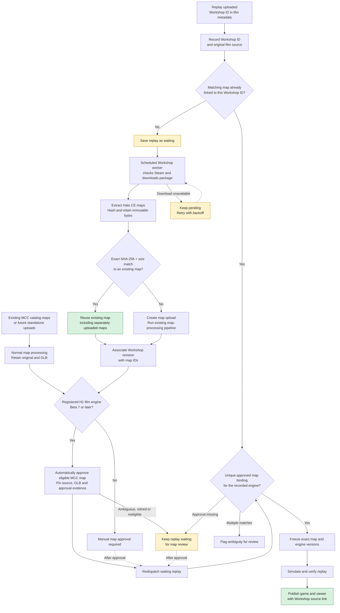
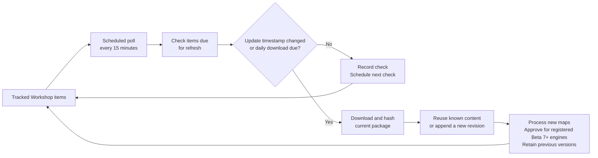

# MCC Workshop map flow

The main flow separates **finding the exact map** from **approving it for replay
processing**. See the [Workshop runbook](WORKSHOP_MAPS.md) for implementation,
deployment, credential setup and rollback details.

## Replay intake and map discovery

## Workshop updates

Updates use the same download and ingestion path:

Successful items become due every **six hours**, with a forced download after
**one day**. Scheduling backlogs can delay checks. Existing games keep their
pinned map and engine versions; updates do not automatically reprocess them.

## Current prerequisites

As of November 13, 2026, authenticated downloads still await dedicated Steam
account setup and verification. Standalone MCC approval does not require Steam
credentials or a Workshop association. Beta 8 engine activation remains a
separate requirement. Once a Beta 7+ engine is registered, scheduled maintenance
also approves eligible existing MCC maps for it. Future direct uploads follow
the same policy. Older and other engines require manual approval.

Automatic approval requires a processed MCC multiplayer map, an active release,
an immutable retained source and a current GLB. Standalone approvals record the
catalog file IDs and processor classification; Workshop approvals additionally
record the matching downloaded revision. The policy preserves manual approvals
and retirements; ambiguity or missing evidence requires review. Campaign/UI maps
are outside this multiplayer replay path. Replay simulation and verification
remain mandatory.
